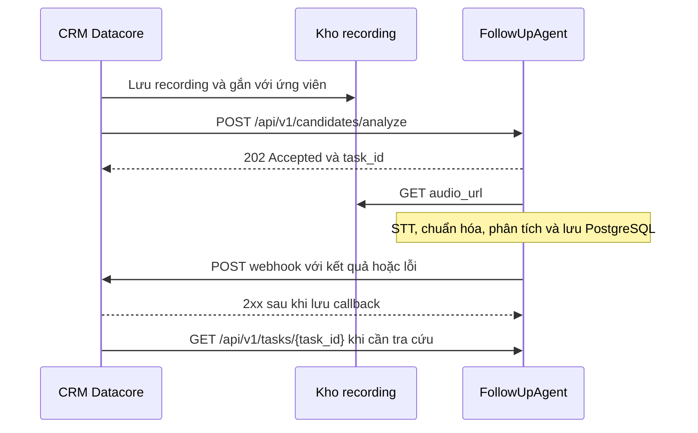

# Bàn giao tích hợp FollowUpAgent cho Datacore

Tài liệu này dành cho đội CRM Datacore triển khai PoC phân tích cuộc gọi tuyển dụng. Các endpoint và JSON bên dưới theo code hiện tại. Đội Datacore và FollowUpAgent cần chốt địa chỉ môi trường, điểm kích hoạt và cách xử lý lỗi trước khi nối hệ thống thật.

## 1. Một recording đi qua hệ thống thế nào



1. **CRM** lưu recording và liên kết nó với ứng viên. Khi file đã tải được, CRM gửi URL audio, mã ứng viên và tên sang FollowUpAgent. Việc gọi API sau sự kiện lưu recording là phần đội Datacore cần nối vào CRM.
2. **FollowUpAgent** nhận request, cấp `task_id` và xử lý ngầm. Service tải audio tạm, chuyển thành transcript, phân loại và tóm tắt. Service lưu kết quả phân tích trong PostgreSQL, tạo lịch theo dõi nội bộ khi có rule tương ứng và gửi kết quả về CRM.
3. **CRM** lưu quan hệ `recording_id` ↔ `task_id` ↔ hồ sơ ứng viên. Một ứng viên có thể có nhiều cuộc gọi, nên gắn kết quả theo recording và task. CRM lưu kết quả từ webhook và hiển thị summary, lý do và hành động cho HR.

[Code điều phối pipeline](../../backend/app/api/v1/endpoints/analyze.py) · [Cách FollowUpAgent tải audio](../../backend/app/audio/service.py)

## 2. CRM gửi một recording đến FollowUpAgent

Gọi `POST /api/v1/candidates/analyze` với header `Content-Type: application/json`. Ghép path này với base URL FollowUpAgent do đội triển khai cung cấp.

```json
{
  "ssn": "CAND-DEMO-001",
  "candidate_name": "Ứng viên demo",
  "audio_url": "https://media.crm.example/recordings/CALL-DEMO-007.wav"
}
```

- `ssn` là mã định danh ứng viên dạng chuỗi theo tên trường của API. Hai đội nên thống nhất dùng mã ứng viên nội bộ làm giá trị liên kết. Service gửi lại nguyên giá trị này trong callback.
- `candidate_name` là tên ứng viên do CRM gửi.
- `audio_url` là URL HTTP hoặc HTTPS mà máy chạy FollowUpAgent có thể tải trực tiếp. Dùng URL dẫn đến file có phần mở rộng phù hợp với cấu hình, mặc định gồm `wav`, `mp3`, `m4a` và `ogg`. Giữ URL tải được trong suốt thời gian chờ xử lý.

Service trả HTTP `202 Accepted`. CRM lưu ngay `task_id` từ phản hồi.

```json
{
  "task_id": "TASK-a1b2c3d4",
  "status": "processing",
  "message": "Audio received and is being processed in the background."
}
```

Request thiếu trường hoặc có URL sai định dạng có thể nhận `422` ngay. Lỗi tải file có thể xảy ra sau `202` và được ghi theo task. Mỗi POST hợp lệ tạo một task mới. CRM nên chống gửi trùng theo `recording_id` và xử lý riêng trường hợp timeout khi chưa biết request đã được nhận hay chưa. [Schema request](../../backend/app/schemas/request.py) · [Endpoint nhận recording](../../backend/app/api/v1/endpoints/analyze.py)

## 3. CRM nhận đầy đủ kết quả qua webhook

Đội Datacore cung cấp một URL nhận `POST` JSON. FollowUpAgent dùng `CRM_WEBHOOK_URL`, với `WEBHOOK_URL` làm giá trị dự phòng. CRM xử lý callback theo `task_id` và trả HTTP `2xx` sau khi lưu. FollowUpAgent có thể gửi lại nếu request timeout hoặc gặp lỗi, nên mỗi `task_id` chỉ nên tạo một bản kết quả ở CRM. [Code gửi webhook](../../backend/app/integrations/webhook.py)

Ví dụ ứng viên sẵn sàng phỏng vấn và hai bên đã thống nhất ngày.

```json
{
  "task_id": "TASK-a1b2c3d4",
  "ssn": "CAND-DEMO-001",
  "status": "completed",
  "result": {
    "summary": "Ứng viên quan tâm vị trí vận hành và xác nhận có thể đến phỏng vấn ngày 27/11.",
    "status_group": 4,
    "reason_code": "HEN_PHONG_VAN",
    "call_decision": "SCHEDULED",
    "appointment_date": "2026-11-27",
    "follow_up_days": null
  }
}
```

- `status` biểu thị trạng thái xử lý kỹ thuật. `result.call_decision` là hành động nghiệp vụ của cuộc gọi.
- `reason_code` giải thích hành động. CRM có thể lưu mã, hiển thị tên phù hợp cho HR và dùng mã để lọc hồ sơ.
- `summary` là văn bản tóm tắt cuộc gọi bằng tiếng Việt để hiển thị cho HR.
- `appointment_date` là ngày phỏng vấn theo dạng `YYYY-MM-DD` khi đã xác nhận. Trường có thể là `null` dù reason code là `HEN_PHONG_VAN`. Ngày nhận việc có thể xuất hiện trong summary.
- `follow_up_days` là số ngày hẹn liên hệ lại dành riêng cho `HEN_XA`. Giá trị mặc định trong trường hợp này là 7 khi thiếu số ngày. Các mã khác trả `null`.
- Payload hiện có các trường ở trên. Lịch `scheduled_at` và cờ cần nghe lại chưa được đưa vào kết quả dành cho CRM. Nếu CRM cần các trường này để tạo việc hoặc phân luồng duyệt, hai đội chốt phần bổ sung contract trước khi triển khai.

[Schema kết quả](../../backend/app/schemas/response.py) · [Quy tắc tính lịch](../../backend/app/followup/rules.py)

### Các decision CRM có thể nhận

- **Nhóm 1 · `NO_CALL`**. `TU_CHOI_LUON`, `KNM_DAP_MAY`, `SAI_SO_NHAM_SO`. Service không tạo lịch gọi lại.
- **Nhóm 2 · `CALL_BACK`**. `KHACH_BAN`, `CUOC_GOI_RONG`, `LOI_AM_THANH`. Cần gọi lại. Rule nội bộ hẹn sau 2 giờ với khách bận, sau 15 phút với hai mã còn lại.
- **Nhóm 3 · `FOLLOW_UP`**. `TRAO_DOI_THEM`, `HEN_XA`. Tiếp tục theo dõi. Rule nội bộ dùng 3 ngày với `TRAO_DOI_THEM` hoặc số ngày hẹn với `HEN_XA`.
- **Nhóm 4 · `SCHEDULED`**. `HEN_PHONG_VAN`. HR xác nhận hoặc nhắc lịch phỏng vấn.
- **Nhóm 5 · `SUCCESS`**. `DI_LAM`. Theo dõi ứng viên nhận việc. Rule nội bộ hẹn sau 2 ngày.

Trong PoC, đề xuất cho HR xem và xác nhận action trên CRM trước khi bật cập nhật hồ sơ tự động. [Bảng quy đổi chuẩn](../../backend/app/classification/codes.py)

### Callback báo lỗi xử lý

```json
{
  "task_id": "TASK-a1b2c3d4",
  "ssn": "CAND-DEMO-001",
  "status": "failed",
  "error": "Không thể tải file, CRM phản hồi mã lỗi: 404"
}
```

CRM ghi nhận lỗi xử lý cho recording tương ứng. Một ca phân tích thành công có reason code `LOI_AM_THANH` vẫn có thể trả `status: "completed"` với action `CALL_BACK`.

## 4. CRM chủ động tra cứu theo task_id

Gọi `GET /api/v1/tasks/{task_id}` khi người dùng muốn xem trạng thái hoặc khi quá thời gian dự kiến mà chưa nhận được webhook. Ví dụ response HTTP `200` trong lúc task đang chạy.

```json
{
  "task_id": "TASK-a1b2c3d4",
  "status": "processing",
  "contact_name": "Ứng viên demo",
  "summary": null,
  "intent": null,
  "error_message": null,
  "created_at": "2026-11-24T02:30:00"
}
```

- Khi task có kết quả, CRM có thể đọc `summary` và `intent`. Giá trị `intent` chính là reason code. Webhook là kênh nhận đủ kết quả, gồm action, ngày phỏng vấn và số ngày follow-up. Endpoint tra cứu hiện không trả các trường này hoặc transcript.
- Sau `202`, polling có thể gặp `404` trong khoảng ngắn trước khi background task lưu bản ghi. Poll lại với khoảng chờ có giới hạn. Nếu tiếp tục không thấy task, kiểm tra phía service theo `task_id`.
- `completed` có thể xuất hiện trước khi webhook được gửi. Dùng callback CRM đã lưu để xác nhận CRM đã nhận kết quả.
- `webhook_failed` cho biết tác vụ đã tới bước gửi webhook nhưng hết lượt thử. CRM vẫn có thể đọc summary và reason code qua polling. Hai đội cần chốt cách lấy lại đầy đủ dữ liệu hoặc gửi lại callback khi cần. Service hiện chỉ tự thử lại trong lúc giao callback, mặc định tối đa 3 lần thử.

[Endpoint tra cứu](../../backend/app/api/v1/endpoints/tasks.py) · [Thứ tự lưu và gửi callback](../../backend/app/api/v1/endpoints/analyze.py)

## 5. Nghiệm thu tích hợp trên môi trường test

- [ ] Thống nhất FollowUpAgent base URL, webhook URL, kết nối hai chiều, xác thực ở môi trường triển khai và mã ứng viên dùng trong `ssn`.
- [ ] Lưu một recording test như luồng thật. CRM gọi đúng endpoint sau khi file tải được và giữ đúng liên kết recording, ứng viên, task.
- [ ] Nhận callback thành công, lưu cả `summary`, `reason_code` và `call_decision`. Kiểm tra hiển thị khi ngày phỏng vấn là `null` và khi có ngày.
- [ ] Gửi lại cùng callback trên môi trường test và kiểm tra CRM chỉ lưu một kết quả. Gửi một audio URL test bị lỗi và kiểm tra CRM hiển thị được lỗi theo task.
- [ ] Cho webhook test trả lỗi tạm thời, kiểm tra retry và trạng thái `webhook_failed` nếu hết lượt. Đo lô 20 request và đối chiếu số callback CRM nhận theo `task_id`.
- [ ] Chốt cách phục hồi task bị ngắt do restart, ai duyệt action và ai xử lý các callback quá hạn. Code hiện tại chạy task trong tiến trình FastAPI, nên lần chạy PoC cần kiểm tra khôi phục nếu đưa vào luồng sử dụng thật.

[Hướng dẫn review và thử tải](pipeline-end-to-end-review.md)
